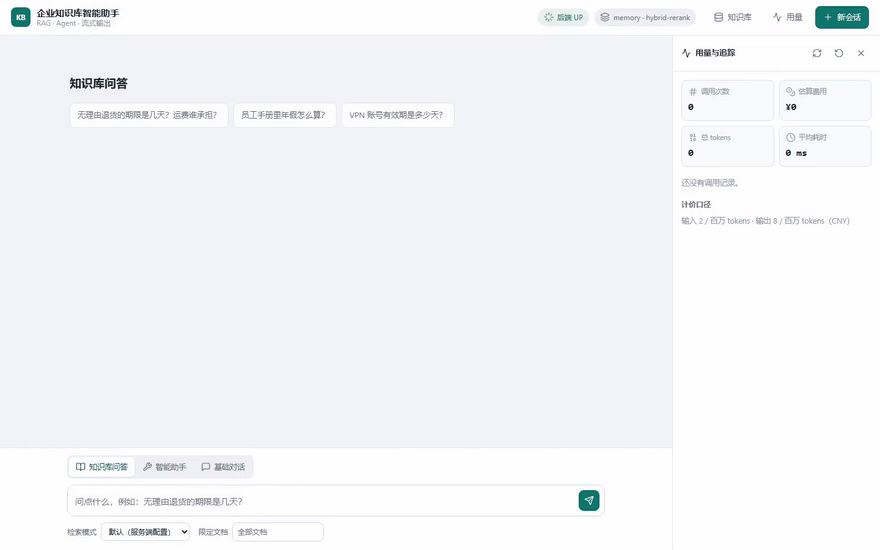
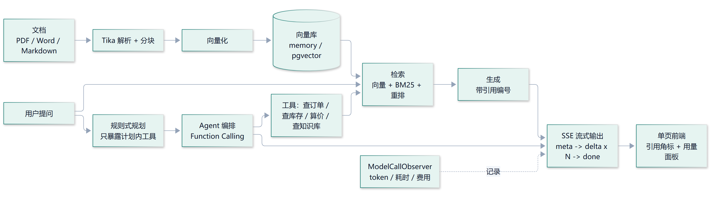

# 企业知识库智能助手

一个能跑通、能评测、能调工具、能规划多步任务、还能现场演示的 **Spring AI + RAG + Agent** 应用。



> 高光片段循环：知识库问答（流式输出 + 点开引用）→ 工具调用详情 → 库存与算价 → 用量成本。
> GitHub 的 README 不能内嵌播放视频，所以这里放 GIF；完整流程（约 1 分半）见
> [`docs/assets/demo.mp4`](docs/assets/demo.mp4)。

## 核心能力

- **RAG 检索增强问答**：真实文档解析（PDF / Word / Markdown / HTML / txt）→ 可配置分块 → 向量化 →
  向量 + BM25 混合检索 + 重排 → 生成答案并标注**可点击的引用来源**，答案能落回「哪个文档、哪一段」；
- **Agent 工具调用**：把查订单、查库存、算价格、查知识库做成工具，用规则式规划器把复杂问题拆成有序步骤，
  只把计划内的工具交给模型（最小权限），并给工具调用补上超时、指数退避重试与失败兜底；
- **产品化**：SSE 流式输出（打字机效果）+ 零构建对话前端 + `docker compose` 一条命令部署 +
  每次模型调用的 token 用量与成本统计。

## 技术栈

| 组件 | 版本 / 选型 |
|---|---|
| JDK | 17 |
| 构建 | Maven |
| 框架 | Spring Boot 3.5.15 |
| AI 框架 | Spring AI 1.1.8 |
| 模型接入 | OpenAI 兼容接口（默认网关内置 DeepSeek 对话模型） |
| 向量库 | `memory`（`SimpleVectorStore`，默认）/ `pgvector` |
| 文档解析 | Apache Tika 3.2.3（PDF / Word / Markdown / HTML / txt 等） |
| 分块策略 | `fixed` / `heading` / `paragraph`，参数可配置 |
| 会话记忆 | Spring AI `ChatMemory` + `MessageWindowChatMemory` |
| 检索优化 | `vector` 基线 / `hybrid`（BM25 + 向量，RRF）/ `hybrid-rerank` |
| RAG 评测 | 26 条内置评测集；Hit Rate、MRR、Precision@K、可选答案与引用准确率 |
| Agent 工具 | Spring AI `@Tool` + `MethodToolCallbackProvider`；工具调用可观测、可测试 |
| Agent 规划与健壮性 | 规则式任务规划器（按计划收敛工具）+ 超时 / 指数退避重试 / 失败兜底 |
| 流式输出 | SSE（`SseEmitter` + Reactor）：`meta → delta × N → done`，失败用 `error` 事件下发 |
| 前端 | 原生 HTML / CSS / JS 单页（零构建），由 Spring Boot 直接托管 |
| 部署 | `Dockerfile` 两阶段构建 + `docker compose up -d --build` 一键起应用与 pgvector |
| 可观测性 | 每次模型调用的 token / 耗时 / 估算费用，按入口与模型汇总 |

## 系统架构

一句话：把「公司文档」和「内部系统」变成模型能用的两种能力 —— **检索（RAG）** 与 **工具调用（Agent）**，
外面再包一层流式对话、评测、部署与成本统计。完整的架构图、数据流与设计取舍见
[`docs/architecture.md`](docs/architecture.md)。



> 图的 mermaid 源码在 [`docs/diagrams/architecture-overview.mmd`](docs/diagrams/architecture-overview.mmd)，
> 由 `scripts/demo/render-diagrams.cjs` 渲染成上面这张 PNG；改图请改 `.mmd`，再跑一次脚本。

三个要点：

- **只有一个模型出口**：换供应商只改 `AI_BASE_URL` / `AI_CHAT_MODEL` / `AI_EMBEDDING_MODEL`；
- **RAG 与 Agent 不是两条平行线**：`searchKnowledgeBase` 这个工具直接复用检索链路；
- **横切关注点只有两个**：`SseStreams`（怎么把结果推给前端）与 `ModelCallObserver`（怎么记账），三个入口共用。

## 快速开始
### 1. 准备 API Key

默认配置使用一个同时提供**对话**与 **Embedding** 的 OpenAI 兼容网关，默认对话模型就是 DeepSeek。
去[硅基流动](https://siliconflow.cn)注册并创建 API Key（用一个 Key 即可跑通全链路）。

> 想换成 DeepSeek 官方 API？见下面「切换模型供应商」。

### 2. 配置环境变量

```bash
export AI_API_KEY="sk-你的真实key"
```

也可以直接用命令行参数或修改 `application.yml`（不建议把 Key 提交到 Git）。

### 3. 启动

```bash
./build.sh spring-boot:run
```

看到 `Started AiKnowledgeAssistantApplication` 即启动成功，默认端口 `8080`。
启动后浏览器打开 [http://localhost:8080](http://localhost:8080) 就是对话界面，
有知识库问答 / 智能助手 / 基础对话三种模式，右上角能看 token 与费用。

### 4. 验证

先测健康检查（不需要 Key）：

```bash
curl http://localhost:8080/api/ping
```

再测基础对话连通性：

```bash
curl -X POST http://localhost:8080/api/chat \
  -H "Content-Type: application/json" \
  -d '{"message":"用一句话介绍你自己"}'
```

导入示例知识库（这一步会调用 Embedding 接口）：

```bash
curl -X POST http://localhost:8080/api/rag/ingest
```

基于知识库提问：

```bash
curl -X POST http://localhost:8080/api/rag/ask \
  -H "Content-Type: application/json" \
  -d '{"question":"无理由退货的期限是几天？运费谁承担？"}'
```

返回里 `answer` 是答案，`sources` 是命中的文档片段来源。

上传一份自己的文档（PDF / Word / Markdown / txt 等）并索引：

```bash
curl -X POST http://localhost:8080/api/rag/upload \
  -F "file=@/path/to/你的文档.pdf" -F "strategy=heading"
```

只想看看不同分块策略怎么切？用 `preview`，它**不调用 embedding、不花钱**：

```bash
curl -X POST http://localhost:8080/api/rag/preview \
  -F "file=@/path/to/你的文档.pdf" -F "strategies=fixed,heading,paragraph" -F "chunkSize=200"
```

## 接口一览

| 方法 | 路径 | 说明 | 需要 Key |
|---|---|---|---|
| GET | `/api/ping` | 健康检查 | 否 |
| POST | `/api/chat` | 基础对话（无知识库），支持 `sessionId` 多轮 | 是 |
| POST | `/api/chat/stream` | 基础对话的 SSE 流式版本 | 是 |
| DELETE | `/api/chat/sessions/{sessionId}` | 清空某个会话的记忆 | 否 |
| POST | `/api/rag/ingest` | 导入示例文档到向量库，可传 `strategy` / `chunkSize` / `overlap` | 是 |
| POST | `/api/rag/upload` | 上传 PDF / Word / Markdown 等文档，解析 + 分块 + 索引 | 是 |
| POST | `/api/rag/preview` | 解析 + 分块预览，可一次对比多种策略与参数 | 否 |
| POST | `/api/rag/ask` | 基于知识库提问，支持 `sessionId` 多轮与 `source` 元数据过滤 | 是 |
| POST | `/api/rag/ask/stream` | RAG 问答的 SSE 流式版本（先推来源，再推答案） | 是 |
| DELETE | `/api/rag/sessions/{sessionId}` | 清空某个会话的对话记忆 | 否 |
| GET | `/api/rag/status` | 当前向量库/检索/记忆参数 | 否 |
| GET | `/api/rag/eval/dataset` | 查看评测问题、期望来源与标准答案 | 否 |
| POST | `/api/rag/eval` | 对比多种检索模式的 Hit Rate / MRR / Precision@K | 是（embedding） |
| POST | `/api/agent/ask` | 带工具调用的问答，返回 `toolsUsed` 与本轮 `toolCalls` | 是 |
| POST | `/api/agent/ask/stream` | Agent 问答的 SSE 流式版本（推计划、答案、工具调用明细） | 是 |
| POST | `/api/agent/plan` | 预览这一轮的任务规划（步骤 + 计划内工具），不调用模型 | 否 |
| GET | `/api/agent/tools` | 当前注册的工具清单（含 JSON Schema） | 否 |
| DELETE | `/api/agent/sessions/{sessionId}` | 清空某个会话的对话记忆 | 否 |
| GET | `/api/observability/usage` | token 用量、估算费用、按入口/模型分解与最近调用 | 否 |
| DELETE | `/api/observability/usage` | 清零累计用量 | 否 |

## 文档索引

**设计与实现**

- [系统架构](docs/architecture.md) — 分层架构图、端到端数据流、模块职责、关键设计取舍、完整目录结构
- [RAG 全链路](docs/rag.md) — 文档解析与分块、混合检索与重排、引用溯源、多轮记忆
- [Agent 全链路](docs/agent.md) — Function Calling、四个工具的设计、规则式规划、超时与重试
- [流式输出与部署](docs/deployment.md) — SSE 协议、前端、容器化部署、token 成本、稳定性排查

**数据与验证**

- [RAG 评测记录](docs/rag-evaluation.md) — 26 条评测集的指标口径与优化前后对比
- [验收清单](docs/acceptance-checklist.md) — 按能力分组的功能验收项

**运行与排查**

- [环境变量与配置](docs/configuration.md) — 全部可覆盖的环境变量与模型切换
- [常见问题](docs/faq.md) — 启动 / 调用 / 检索 / Agent / 部署的排查思路
- [关键概念速查](docs/key-concepts.md) — 会被追问的概念，一句话讲清

> 更细的实现与实测记录：[agent-tool-calling.md](docs/agent-tool-calling.md)、
> [agent-robustness.md](docs/agent-robustness.md)、[productization.md](docs/productization.md)。
> 演示录制与架构图渲染脚本在 [`scripts/demo/`](scripts/demo)。
