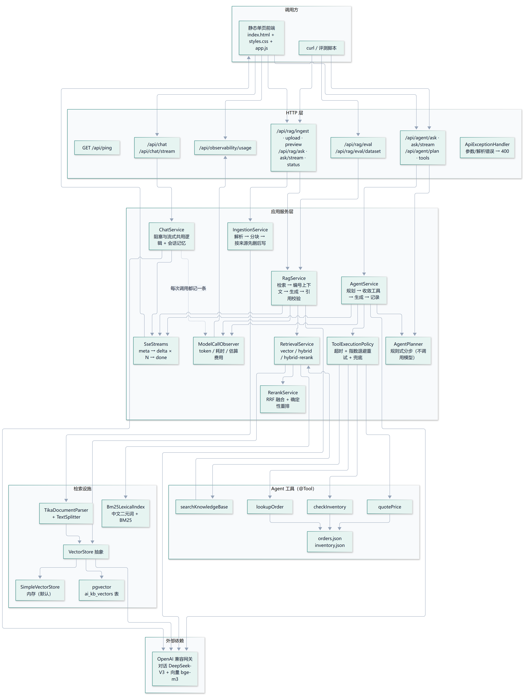
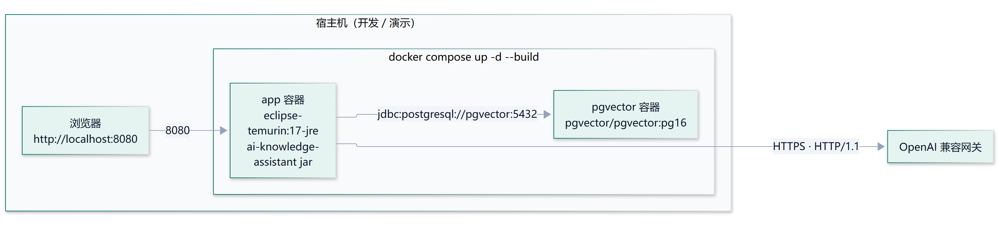

# 系统架构与数据流

> 一句话定位：把「公司文档」和「内部系统」变成模型能用的两种能力 —— **检索（RAG）** 与 **工具调用（Agent）**，
> 再把它们装进一个能流式对话、能评测、能部署、能算成本的 Spring Boot 应用里。
>
> 本文是 README「系统架构」一节的展开版：完整的模块职责、端到端数据流，以及每个关键取舍的**理由与代价**。
> 需要「画一张架构图」时，画第 1 节这张，再用第 2 节的两条数据流把它讲活。

---

## 1. 分层总览



> 图的 mermaid 源码在 [`diagrams/architecture-layers.mmd`](diagrams/architecture-layers.mmd)，
> 由 `scripts/demo/render-diagrams.cjs` 渲染成上面这张 PNG；改图请改 `.mmd`，再跑一次脚本。

读图要点：

- **只有一个模型出口**：对话、检索、工具编排最终都落到同一个 OpenAI 兼容网关，换供应商只改 `AI_BASE_URL` / `AI_CHAT_MODEL` / `AI_EMBEDDING_MODEL`。
- **RAG 与 Agent 不是两条平行线**：`searchKnowledgeBase` 这个工具直接复用 `RetrievalService`，
  所以混合检索的能力，Agent 一开箱就能用。
- **横切关注点只有两个**：`SseStreams`（怎么把结果推给前端）和 `ModelCallObserver`（怎么记账），
  三个入口共用，不重复实现。

---

## 2. 端到端数据流

### 2.1 知识入库（Ingestion）

```
文档（PDF / Word / Markdown / HTML / txt）
  │  POST /api/rag/upload（或 /ingest 导入内置示例）
  ▼
TikaDocumentParser            抽取纯文本 + 元数据（文件名、格式）
  ▼
TextSplitter（fixed / heading / paragraph）
  每个片段带：文本 + 标题路径 + 来源
  ▼
IngestionService
  ├─ 按 source 先删后写（同一文档重复导入不叠加）
  └─ 按 32 片一批写向量库，打进度日志
  ▼
VectorStore（memory 或 pgvector）
  └─ 同时写入 Bm25LexicalIndex（关键词索引，内存态）
```

关键点：**「先删后写」是幂等的关键**。以 `source` 为过滤条件先删掉旧片段，再写新片段，
同一份文档重复导入不会产生重复条目 —— 这也顺带演示了「元数据过滤」不只是给检索用的。

### 2.2 RAG 问答（含引用溯源）

```
问题 + （可选）sessionId
  ▼
RetrievalService.retrieve(question)
  ├─ 向量召回 topN ─┐
  └─ BM25 召回 topN ─┴─► RerankService（加权 RRF + 覆盖率/标题 tie-break）→ topK 片段
  ▼
RagService
  ├─ 给片段编号 [1] [2] …，拼成「参考资料」上下文
  ├─ 注入系统提示：只依据资料作答，无法作答就明说
  ├─ 带上会话记忆调用对话模型（阻塞或流式）
  └─ 校验答案里的引用编号，映射回 来源 / 位置 / 原文片段
  ▼
RagAnswer{ answer, citations[], sources[], usage }
```

关键点：**引用不是模型随口写的数字**。编号由系统在「拼上下文」时分配，
返回前再校验一遍：答案里出现的 `[n]` 必须能对应到真实片段，否则不认。
这是「可追溯」与「看起来像引用」的区别。

### 2.3 Agent 问答（多步工具）

```
问题 + （可选）sessionId
  ▼
AgentPlanner.plan(question)           ← 规则式，毫秒级、不花钱、可单测
  → 有序步骤 + 计划内工具（如 lookupOrder + searchKnowledgeBase）
  ▼
AgentToolRegistry.callbacksFor(plan)  ← 最小权限：只暴露计划内的工具
  ▼
ChatClient（注入计划提示 + 裁剪后的工具）→ 模型决定「调哪个、传什么参数」
  ▼
ToolExecutionPolicy 包装每次工具调用
  ├─ 独立线程执行 + 超时（默认 2000ms）
  ├─ 失败按 50ms → 100ms → 200ms 指数退避重试（默认最多 3 次）
  └─ 重试耗尽 → 返回结构化兜底提示，整轮请求不失败（degraded=true）
  ▼
RecordingToolCallback 记录：工具名 / 参数 / 结果 / 耗时 / 尝试次数
  ▼
AgentAnswer{ answer, plan, toolsUsed, toolCalls[], degraded }
```

关键点：**规划器只出「骨架」，模型跑「循环」**。
规划器决定「先查订单、再查政策」，但每一步怎么填参数、要不要再补一次调用，
仍由模型在 Spring AI 的编排循环里决定 —— 对应 ReAct 的「思考 → 行动 → 观察 → 再思考」。

### 2.4 流式协议（三个入口共用）

```
POST /api/{chat|rag|agent}/…/stream
  ▼
开始推流前：参数校验 / RAG 检索失败 → 直接抛异常，走 HTTP 400 / 500
  ▼
SseStreams.toEmitter(Flux<StreamEvent>)
  event: meta   {sessionId, mode, sources, plan}   ← 第一帧就把「这一轮干什么」说清
  event: delta  {text} × N                          ← 逐片追加 = 打字机效果
  event: done   {citations, toolCalls, usage, estimatedCost, durationMs, degraded}
  event: error  {message}                           ← 推流开始之后的失败只能这么下发
```

关键点：**错误分两个时间点**。推流一旦开始，HTTP 状态码就已经是 200，改不成 500，
所以「还没回答就失败」用 HTTP 语义（更诚实），「回答到一半失败」用 `error` 事件。

---

## 3. 模块职责

| 包 / 目录 | 职责 |
|---|---|
| `chat/` | 基础对话、会话记忆（滑动窗口）、阻塞与流式共用逻辑 |
| `rag/` | 解析、分块、入库、检索、生成、引用校验、状态 |
| `rag/parser/` | Tika 多格式解析，接口化便于替换 |
| `rag/splitter/` | `fixed` / `heading` / `paragraph` 三种分块策略 |
| `rag/eval/` | 26 条评测集、指标计算、评测接口 |
| `agent/` | 工具注册、记录、编排、入口 |
| `agent/tool/` | 四个 `@Tool`：`lookupOrder` / `checkInventory` / `quotePrice` / `searchKnowledgeBase` |
| `agent/plan/` | 规则式任务规划器与计划模型 |
| `agent/data/` | JSON 模拟的内部订单与库存系统 |
| `stream/` | 事件协议、SSE 适配、空闲超时守护 |
| `observability/` | 模型调用配对记录、token / 费用汇总、用量接口 |
| `config/` | 向量库 Bean、HTTP 客户端（超时 / HTTP/1.1）、可注入 Clock |
| `web/` | 健康检查、统一异常处理 |
| `resources/static/` | 零构建单页前端 |

---

## 4. 关键设计取舍

| 决策 | 选了什么 | 理由 | 代价 / 边界 |
|---|---|---|---|
| AI 框架 | **Spring AI 1.1.8** | 团队已有 Java / Spring 工程能力，不为一个 Demo 换语言栈 | 生态与文档比 LangChain 少了些；部分能力要自己补 |
| 向量库 | 默认 **内存**，可选 **pgvector** | 起步零依赖，一条配置切到持久化；上层只依赖 `VectorStore` 接口 | pgvector 表结构/维度需与 embedding 模型一致，换模型要重建 |
| 检索 | **混合检索 + 重排**（默认） | 关键词精确命中（「定制」「A1001」）是纯向量的弱项 | 多一次候选召回与重排，延迟约 +3ms（检索层） |
| 任务规划 | **规则式规划器**，不让模型规划 | 毫秒级、不花钱、可单测、可解释，还能收敛工具权限 | 关键词覆盖不到的任务识别不出，会退回全量工具 |
| 引用溯源 | 系统分配编号 → 写进提示词 → 返回前校验 | 编号可控、可追溯，能把答案落回「哪个文档哪一段」 | 依赖模型愿意标注编号；标注缺失时引用为空 |
| 流式实现 | **`SseEmitter`**，不直接返回 `Flux` | 事件名、JSON 序列化、超时、断线清理都握在自己手里 | 要手动订阅 Reactor 流并在 `onCompletion` 里 `dispose` |
| HTTP 协议 | **固定 HTTP/1.1** | 实测 WSL + docker NAT 链路上 HTTP/2 长连接会静默卡死 | 放弃 HTTP/2 的多路复用；可用环境变量切回做对照 |
| 用量统计 | 进程内内存汇总 | 演示与自测够用，零外部依赖 | 重启清零、多副本不共享；生产应换 Micrometer + Prometheus |
| 前端 | **零构建单页**（原生 HTML/CSS/JS） | 这个项目是给人演示的，改完刷新即见效 | 没有打包、类型与单测，不足以长期维护 |

> 这张表就是「技术选型」的依据：**每个选择都能说出理由，也能说出它的代价**。
> 只讲「我用了 X」不够，讲清「为什么不用 Y、X 的代价是什么」才算做过决策。

---

## 5. 部署拓扑



> 图的 mermaid 源码在 [`diagrams/architecture-deploy.mmd`](diagrams/architecture-deploy.mmd)，
> 由 `scripts/demo/render-diagrams.cjs` 渲染成上面这张 PNG。

要点：

- `Dockerfile` 两阶段构建：`maven:3.9-eclipse-temurin-17` 里打包，`eclipse-temurin:17-jre` 里运行，运行时用 `-XX:MaxRAMPercentage=75` 按容器内存给堆设上限。
- `app` 通过 `depends_on: pgvector: condition: service_healthy` 等数据库健康检查通过再启动，并注入 `AIKB_VECTOR_STORE=pgvector`。
- 一键起的是**持久化形态**，不是内存版：重启容器索引不丢，关键词索引在启动时从向量库重建。

---

## 6. 已知边界（主动讲出来）

- 评测集只有 **26 条、3 份文档**，向量检索在这份集合上已经饱和（Hit Rate / MRR = 1.0），
  它证明的是「评测链路可跑通」，不是「在任意语料上都够好」；真实生产要加入相似章节、编号类问题与干扰文档。
- 关键词索引是**内存态**，重启靠启动时重建（只读数据库、不调用模型）。
- 用量统计**只在进程内**，多副本不共享，embedding 的 token 未计入。
- `agent/data/` 是 **JSON 模拟**的订单与库存，不是真实内部系统对接。
- 前端零构建，没有类型检查与自动化测试；流式下每个 `delta` 都会整段重渲染 Markdown，长答案有开销。
- 没有断线重连（`Last-Event-ID`）、没有鉴权与多租户、没有 `/actuator/prometheus` 指标端点。

> 「我知道它到哪一步为止」这件事本身就是工程判断力。主动说清边界，比被追问才承认要好得多。

---

## 附：完整目录结构

```
src/main/java/com/example/aikb
├── AiKnowledgeAssistantApplication.java   # 启动类
├── chat/                                  # 基础对话 + 多轮记忆
│   ├── ChatController.java                # 含 /stream
│   ├── ChatService.java                   # 阻塞式与流式共用一套逻辑与会话记忆
│   ├── ChatRequest.java / ChatResponse.java
│   ├── ChatMemoryProperties.java          # app.chat.memory.* 配置
│   └── ConversationMemoryService.java     # 会话记忆（滑动窗口）
├── stream/                                # SSE 流式输出的公共设施
│   ├── StreamEvent.java                   # 事件协议：meta / delta / done / error
│   ├── StreamPayloads.java                # 各类事件的载荷（含按模式构造的工厂方法）
│   ├── SseStreams.java                    # Flux<StreamEvent> -> SseEmitter（超时与断开清理）
│   ├── ChatResponses.java                 # 流式分片取文本（处理「只有用量没内容」的分片）
│   └── StreamProperties.java              # app.stream.* 配置
├── observability/                         # 模型调用用量与成本统计
│   ├── ModelCallObserver.java             # 一次调用配对：startCall / observe / finish / fail
│   ├── ModelCallRecord.java / TokenUsage.java / UsageBreakdown.java / UsageSummary.java
│   ├── ObservabilityProperties.java       # app.observability.*（单价与保留条数）
│   └── ObservabilityController.java       # /api/observability/usage
├── config/                                # 配置
│   ├── RagConfig.java                     # 按配置声明 memory / pgvector 向量库 Bean
│   └── AgentConfig.java                   # 可注入的 Clock（让时间相关工具可测试）
├── agent/                                 # Agent / Function Calling
│   ├── AgentController.java               # /ask、/plan、/tools、/sessions
│   ├── AgentService.java                  # 规划 -> 收敛工具 -> 生成 -> 记录本轮工具调用
│   ├── AgentToolRegistry.java             # 把 @Tool 方法变成 ToolCallback；支持按计划裁剪
│   ├── ToolExecutionPolicy.java           # 超时 + 指数退避重试 + 故障注入
│   ├── RecordingToolCallback.java         # 装饰器：记录工具名/参数/结果/耗时/尝试次数
│   ├── ToolCallRecorder.java              # ThreadLocal 收集本轮调用 + 次数上限保护
│   ├── ToolCallRecord.java / ToolDescriptor.java / AgentProperties.java
│   ├── plan/                              # 规则式任务规划
│   │   ├── AgentPlanner.java              # 把问题拆成有序步骤 + 渲染给模型的提示词
│   │   └── Plan.java                      # 计划结构：步骤 + 计划内工具 + 规划理由
│   ├── tool/                              # 四个工具：查订单 / 查库存 / 算价格 / 查知识库
│   ├── model/                             # 工具返回结构（只给事实，不给结论）
│   └── data/                              # JSON 模拟的内部订单与库存系统
├── rag/                                   # RAG 核心
│   ├── RagController.java                 # /ingest、/upload、/preview、/ask、/status、/sessions
│   ├── RagService.java                    # 检索 + 编号上下文 + 生成 + 引用校验 + 记忆写入
│   ├── RetrievalService.java              # vector / hybrid / hybrid-rerank 三档检索
│   ├── RetrievedChunk.java / SourceRef.java  # 带来源/分数/定位的命中片段
│   ├── RetrievalMode.java                 # 检索模式枚举
│   ├── Bm25LexicalIndex.java              # 中文二元词 + BM25 关键词索引
│   ├── RerankService.java                 # RRF 融合与确定性重排
│   ├── eval/                              # 评测集、指标与评测接口
│   ├── IngestionService.java              # 解析 -> 分块 -> 按来源先删后写向量库；preview 只分块
│   ├── IngestResponse.java                # 含 documents / chunks / strategy / sources
│   ├── PreviewResponse.java / ChunkPreview.java / StrategyPreview.java
│   ├── SimpleTextSplitter.java            # 固定长度 + 重叠的底层切分
│   ├── RagProperties.java                 # app.rag.* 配置（含 vector-store / dimensions）
│   ├── VectorStoreType.java               # memory / pgvector
│   ├── parser/                            # 多格式文档解析
│   │   ├── DocumentParser.java            # 解析接口，便于替换/扩展
│   │   ├── TikaDocumentParser.java        # Tika 实现：PDF / Word / Markdown / HTML / txt
│   │   ├── ParsedDocument.java
│   │   └── DocumentParseException.java / UnsupportedDocumentException.java
│   └── splitter/                          # 可配置分块
│       ├── ChunkingStrategy.java          # fixed / heading / paragraph
│       ├── ChunkingOptions.java           # 策略 + chunkSize + overlap
│       ├── TextChunk.java                 # 片段文本 + 标题路径
│       └── TextSplitter.java              # 三种策略实现
└── web/                                   # HTTP 层
    ├── PingController.java                # /api/ping 健康检查
    └── ApiExceptionHandler.java           # 解析/参数错误 -> 400
src/main/resources
├── application.yml                        # 模型、RAG、上传大小配置
├── static/                                # 对话前端（index.html / styles.css / app.js）
├── prompts/system-prompt.txt              # 系统提示词（UTF-8，独立于源码）
├── prompts/agent-prompt.txt               # Agent 系统提示词（何时用哪个工具）
├── agent/orders.json / inventory.json     # 模拟订单与库存数据
├── evaluation/rag-eval.json               # 26 条评测问题与标准来源
└── sample-docs/                           # 三个示例文档（Markdown + txt）
docker-compose.yml                         # pgvector 持久化 + app 服务，一条命令起全套
Dockerfile / .dockerignore                 # 两阶段构建应用镜像
scripts/                                   # 一键跑 RAG 评测
```

相关文档：[README](../README.md) · [RAG 全链路](rag.md) · [Agent 全链路](agent.md) · [流式输出与部署](deployment.md)
